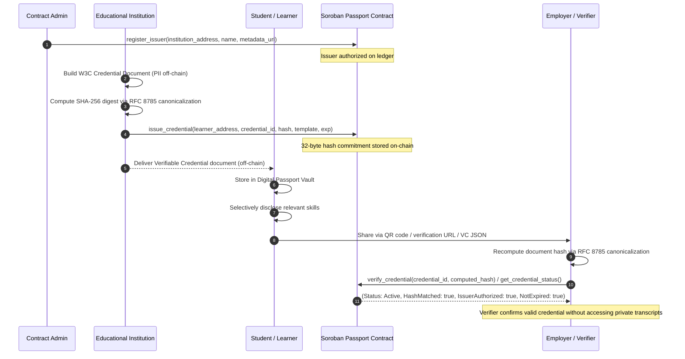

# Decentralized Global Education & Skills Passport — Architecture

High-level architecture, system boundaries, credential lifecycle, and component mapping of the monorepo.

---

## 1. Product Mission & System Architecture

The **Decentralized Global Education & Skills Passport** is a decentralized, privacy-preserving educational credentialing and verifiable skills platform built on Stellar Soroban.

The platform provides two complementary blockchain primitives:
1. **Education Passport Core (`contracts/passport`)**: The primary product — authorized institutional issuer registry, W3C Verifiable Credential hash commitments, auditable on-chain revocation/suspension lifecycle, and independent verification with zero on-chain personally identifiable information (PII).
2. **Sealed Allocation & Coordination Protocol (`contracts/round`)**: A fair commit–reveal primitive utilizing Drand timelock encryption and Stellar Asset Contract (SAC) settlement, used for blind grant scoring, academic hackathon prize allocation, sealed RFP appraisals, and merit-based bounties.

```text
┌────────────────────────────────────────────────────────────────────────────────────────┐
│                                    USER INTERFACES                                     │
│   ┌────────────────────────┐  ┌───────────────────────────┐  ┌──────────────────────┐  │
│   │   Learner Vault        │  │  Institution Console      │  │  Employer Verifier   │  │
│   │   (QR / Selective View)│  │  (Issuance / Revocation)  │  │  (Status & Proof)    │  │
│   └───────────┬────────────┘  └─────────────┬─────────────┘  └───────────┬──────────┘  │
│               │ (W3C VC Payload)            │ (Issue / Revoke)           │ (Verify)    │
│               ▼                             ▼                            ▼             │
├────────────────────────────────────────────────────────────────────────────────────────┤
│                          SKILLS PASSPORT TYPESCRIPT SDK                                │
│   • RFC 8785 JSON Canonicalization (JCS)        • Base64url Sharing & QR Code Engine   │
│   • SHA-256 Hash Commitment Calculator          • Offline / Online Verifier Pipeline   │
│   • EducationPassportClient (Soroban RPC)       • Selective Disclosure Filtering       │
├────────────────────────────────────────────────────────────────────────────────────────┤
│                                 STELLAR BLOCKCHAIN                                     │
│  ┌─────────────────────────────────────────┐  ┌─────────────────────────────────────┐  │
│  │   contracts/passport (Core Registry)    │  │   contracts/round (Sealed Bidding)  │  │
│  │   • Authorized Issuers & Metadata       │  │   • Commit-Reveal Coordination      │  │
│  │   • 32-Byte Credential Hash Commitments │  │   • Drand BLS On-Chain Verification │  │
│  │   • Revocation & Suspension Lifecycle   │  │   • SAC Token Escrow & Settle       │  │
│  │   • Replay & Substitution Protection    │  │   • Autonomous Keeper Support       │  │
│  └─────────────────────────────────────────┘  └─────────────────────────────────────┘  │
└────────────────────────────────────────────────────────────────────────────────────────┘
```

---

## 2. Component Directory Map

| Path | Layer | Responsibility |
| --- | --- | --- |
| **`contracts/passport/`** | **Core On-Chain** | Primary Soroban contract: issuer registration, credential hash commitments, revocation, suspension, and verification. |
| **`contracts/round/`** | **Allocation On-Chain** | Sealed commit-reveal coordination: escrow locking, Drand BLS signature verification, SAC settlement. |
| **`packages/sdk/`** | **Client & Protocol** | `EducationPassportClient`, W3C Verifiable Credential schema builders, RFC 8785 canonical hashing, and `SkillsPassportClient`. |
| **`packages/round-bindings/`** | **Generated Bindings** | Spec-accurate TypeScript contract bindings generated from `contracts/round` WASM. |
| **`packages/tlock/`** | **Cryptographic Tools** | Timelock encryption to Drand beacon rounds and auditor identity ciphertext encapsulation. |
| **`apps/web/`** | **Frontend Application** | React 19 UI: Learner Vault, Institution Issuance Console, Employer Verifier, and Allocation Observer. |
| **`services/keeper/`** | **Automation Daemon** | Permissionless keeper for Drand reveal and round clearing on Stellar testnet/mainnet. |
| **`services/appraisal-api/`** | **Micro-payment Service**| x402-gated valuation API funded via testnet USDC payments. |
| **`services/agent/`** | **Agent Engine** | Autonomous sealed-bid agents executing under principal-signed mandates. |
| **`services/receipt-cli/`** | **Audit Tools** | Export and independently verify round execution receipts offline. |
| **`examples/grant-scoring/`** | **Reference Pilot** | Sealed grant evaluation and scoring template. |

---

## 3. Credential Lifecycle & Data Flow



---

## 4. Privacy Guarantees & Separation of Concerns

1. **Zero On-Chain PII**: Learner names, national identification numbers, grades, course syllabi, and internal academic remarks are **never stored on public Stellar Soroban storage**.
2. **Cryptographic Commitments**: Credentials adhere to the W3C Verifiable Credentials data model. The JSON payload is canonicalized using RFC 8785 (JSON Canonicalization Scheme) and hashed using SHA-256. Only the resulting 32-byte digest is anchored to the contract storage.
3. **Selective Disclosure**: Learners can generate views containing only selected skills or competencies. Because the credential ID and issuer DID remain anchored, verifiers can inspect both the full credential and selective views while confirming that unselected records were not leaked.
4. **Instant Revocation & Suspension**: Institutions can revoke or suspend credentials on-chain. When a credential is revoked, it becomes immediately invalid globally with an immutable reason string for auditable defense against academic fraud.

---

## 5. Storage Model (Soroban Ledger)

### Education Passport (`contracts/passport`)
| Tier | Key / Record | Contents | Lifetime |
| --- | --- | --- | --- |
| **Instance** | `Admin` | Primary contract administrator address | Contract lifetime |
| **Persistent** | `Issuer(address)` | Authorized institution profile, status, accreditation URI | Until deauthorized |
| **Persistent** | `Template(symbol)`| Credential schema definition, name, standard metadata | Indefinite |
| **Persistent** | `Credential(id)` | 32-byte SHA-256 hash, issuer address, recipient address, status (`Active`, `Revoked`, `Suspended`), issued_at, expires_at, revocation_reason | Indefinite (verifiable historical record) |

### Sealed Allocation Round (`contracts/round`)
| Tier | Key / Record | Contents | Lifetime |
| --- | --- | --- | --- |
| **Instance** | Config | Drand network pubkey, DST, genesis time, SAC token address | Contract lifetime |
| **Persistent** | Round | Deadlines, Drand round R, status, clearing rule, winner | Until settle or void |
| **Persistent** | Bidder Escrow | Escrow amounts, revealed values per participant | Until settle or void |
| **Temporary** | Sealed Bid | Ciphertext + auditor blob | Expires after reveal window |

---

## 6. Trust Boundaries

| Component | Trusted For | Not Trusted For |
| --- | --- | --- |
| **Passport Contract** | Cryptographic hash binding, authorized issuer list, revocation status | Off-chain transcript storage (kept off-chain) |
| **Issuing Institution** | Conferred academic merit, accurate grades, honest credential issuance | Modifying credentials post-issuance (hashes cannot be retroactively changed) |
| **Learner** | Storing private credential payloads, selecting what to share | Altering grades or substituting recipient DID (tampering breaks hash match) |
| **Employer / Verifier** | Verifying authenticity against Soroban RPC | Fabricating proof results or overriding on-chain revocation |
| **Round Contract** | Escrow locking, commit hash binding, BLS verification, token distribution | Off-chain mandate enforcement |
| **Drand Beacon** | Unbiased randomness and round-R BLS signatures | Guaranteeing round clearing liveness |
| **Keeper Service** | Triggering open/reveal/clear/settle lifecycle calls | Secrecy before round R |

---

## 7. Verified Verification Commands

```bash
# 1. Full Workspace Tests (Rust contracts + TypeScript SDK + Web app)
pnpm test

# 2. Automated 10-Scenario End-to-End Passport Lifecycle
pnpm lifecycle:passport

# 3. Command-Line Credential Verifier
pnpm passport:verify --demo

# 4. Soroban Smart Contract Unit Tests
cargo test --workspace

# 5. Typecheck All Workspace Packages
pnpm -r --workspace-concurrency=1 run typecheck
```
