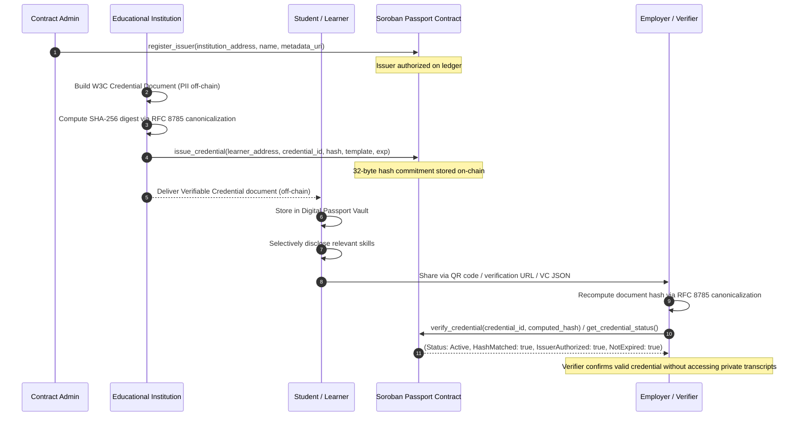

# Decentralized Global Education & Skills Passport — Architecture

High-level architecture, system boundaries, credential lifecycle, and component mapping of the monorepo.

---

## 1. Product Mission & System Architecture

The **Decentralized Global Education & Skills Passport** is a decentralized, privacy-preserving educational credentialing and verifiable skills platform built on Stellar Soroban.

The platform provides two complementary blockchain primitives:
1. **Education Passport Core (`contracts/passport`)**: The primary product — authorized institutional issuer registry, W3C Verifiable Credential hash commitments, auditable on-chain revocation/suspension lifecycle, and independent verification with zero on-chain personally identifiable information (PII).
2. **Sealed Allocation & Coordination Protocol (`contracts/round`)**: A fair commit–reveal primitive utilizing Drand timelock encryption and Stellar Asset Contract (SAC) settlement, used for blind grant scoring, academic hackathon prize allocation, sealed RFP appraisals, and merit-based bounties.

```text
┌────────────────────────────────────────────────────────────────────────────────────────┐
│                                    USER INTERFACES                                     │
│   ┌────────────────────────┐  ┌───────────────────────────┐  ┌──────────────────────┐  │
│   │   Learner Vault        │  │  Institution Console      │  │  Employer Verifier   │  │
│   │   (QR / Selective View)│  │  (Issuance / Revocation)  │  │  (Status & Proof)    │  │
│   └───────────┬────────────┘  └─────────────┬─────────────┘  └───────────┬──────────┘  │
│               │ (W3C VC Payload)            │ (Issue / Revoke)           │ (Verify)    │
│               ▼                             ▼                            ▼             │
├────────────────────────────────────────────────────────────────────────────────────────┤
│                          SKILLS PASSPORT TYPESCRIPT SDK                                │
│   • RFC 8785 JSON Canonicalization (JCS)        • Base64url Sharing & QR Code Engine   │
│   • SHA-256 Hash Commitment Calculator          • Offline / Online Verifier Pipeline   │
│   • EducationPassportClient (Soroban RPC)       • Selective Disclosure Filtering       │
├────────────────────────────────────────────────────────────────────────────────────────┤
│                                 STELLAR BLOCKCHAIN                                     │
│  ┌─────────────────────────────────────────┐  ┌─────────────────────────────────────┐  │
│  │   contracts/passport (Core Registry)    │  │   contracts/round (Sealed Bidding)  │  │
│  │   • Authorized Issuers & Metadata       │  │   • Commit-Reveal Coordination      │  │
│  │   • 32-Byte Credential Hash Commitments │  │   • Drand BLS On-Chain Verification │  │
│  │   • Revocation & Suspension Lifecycle   │  │   • SAC Token Escrow & Settle       │  │
│  │   • Replay & Substitution Protection    │  │   • Autonomous Keeper Support       │  │
│  └─────────────────────────────────────────┘  └─────────────────────────────────────┘  │
└────────────────────────────────────────────────────────────────────────────────────────┘
```

---

## 2. Component Directory Map

| Path | Layer | Responsibility |
| --- | --- | --- |
| **`contracts/passport/`** | **Core On-Chain** | Primary Soroban contract: issuer registration, credential hash commitments, revocation, suspension, and verification. |
| **`contracts/round/`** | **Allocation On-Chain** | Sealed commit-reveal coordination: escrow locking, Drand BLS signature verification, SAC settlement. |
| **`packages/sdk/`** | **Client & Protocol** | `EducationPassportClient`, W3C Verifiable Credential schema builders, RFC 8785 canonical hashing, and `SkillsPassportClient`. |
| **`packages/round-bindings/`** | **Generated Bindings** | Spec-accurate TypeScript contract bindings generated from `contracts/round` WASM. |
| **`packages/tlock/`** | **Cryptographic Tools** | Timelock encryption to Drand beacon rounds and auditor identity ciphertext encapsulation. |
| **`apps/web/`** | **Frontend Application** | React 19 UI: Learner Vault, Institution Issuance Console, Employer Verifier, and Allocation Observer. |
| **`services/keeper/`** | **Automation Daemon** | Permissionless keeper for Drand reveal and round clearing on Stellar testnet/mainnet. |
| **`services/appraisal-api/`** | **Micro-payment Service**| x402-gated valuation API funded via testnet USDC payments. |
| **`services/agent/`** | **Agent Engine** | Autonomous sealed-bid agents executing under principal-signed mandates. |
| **`services/receipt-cli/`** | **Audit Tools** | Export and independently verify round execution receipts offline. |
| **`examples/grant-scoring/`** | **Reference Pilot** | Sealed grant evaluation and scoring template. |

---

## 3. Credential Lifecycle & Data Flow



---

## 4. Privacy Guarantees & Separation of Concerns

1. **Zero On-Chain PII**: Learner names, national identification numbers, grades, course syllabi, and internal academic remarks are **never stored on public Stellar Soroban storage**. Note that Stellar public addresses (`issuer`, `recipient`), 32-byte `credential_id`, 32-byte `credential_hash`, `template_id`, timestamps, and revocation/suspension status + reasons remain publicly visible on ledger.
2. **Cryptographic Commitments & Optional W3C Data Integrity**: Credentials follow W3C Verifiable Credentials Data Model v1.1, canonicalized with RFC 8785 (UTF-16 code-unit JCS) and hashed with SHA-256. Issuers may also attach standard W3C **`DataIntegrityProof` (`cryptosuite: "eddsa-jcs-2022"`)** Ed25519 signatures over the canonical document + proof configuration.
3. **Salted Selective Disclosure vs. Zero-Knowledge Proofs**: Issuing with `selectiveDisclosure: true` (`StellarSorobanSaltedClaims2026`) commits each claim individually with a 128-bit CSPRNG salt. Learners can share redacted views omitting unneeded fields and their salts while remaining cryptographically verifiable against the on-chain root digest. This protects omitted claim preimages from dictionary guessing, **but** presentations remain linkable via `credentialHash` / `credentialId` (not ZK-SNARKs or BBS+ unlinkable proofs).
4. **URL Fragment & Client Storage Hygiene**: Verification links place parameters in `#/passport/verify` (never HTTP query strings) and the web UI scrubs fragments via `window.history.replaceState` after load; however, URLs still appear in browser history/clipboard until cleared. Client storage defaults to demo `localStorage` with optional **PBKDF2-SHA256 (150k iterations) + AES-256-GCM** encrypted vault + `.skp-vault.json` backup export/import.
5. **Instant Revocation & Suspension**: Authorized institutions can revoke or suspend credentials on-chain, and admins can execute two-step admin transfer (`propose_admin`/`accept_admin`), emergency `pause`/`unpause`, and `rotate_issuer_key`.

---

## 5. Storage Model (Soroban Ledger)

### Education Passport (`contracts/passport`)
| Tier | Key / Record | Contents | Lifetime |
| --- | --- | --- | --- |
| **Instance** | `Admin`, `PendingAdmin`, `Paused` | Contract administrator, two-step transfer nominee, circuit-breaker pause flag | Contract lifetime |
| **Persistent** | `Issuer(address)` | Authorized institution profile, status, accreditation URI | Until deauthorized / rotated |
| **Persistent** | `Template(symbol)` | Credential schema definition, registering issuer owner, metadata | Indefinite |
| **Persistent** | `Credential(id)` | 32-byte SHA-256 hash, issuer address, recipient address, status (`Active`, `Revoked`, `Suspended`), issued_at, expires_at, revocation_reason | Indefinite (verifiable historical record) |
| **Persistent** | `LearnerCredentials(addr)` | Indexed credential ID list for learner lookups & pagination (`get_learner_credentials_page`) | Indefinite |

### Sealed Allocation Round (`contracts/round`)
| Tier | Key / Record | Contents | Lifetime |
| --- | --- | --- | --- |
| **Instance** | Config | Drand network pubkey, DST, genesis time, SAC token address | Contract lifetime |
| **Persistent** | Round | Deadlines, Drand round R, status, clearing rule, winner | Until settle or void |
| **Persistent** | Bidder Escrow | Escrow amounts, revealed values per participant | Until settle or void |
| **Temporary** | Sealed Bid | Ciphertext + auditor blob | Expires after reveal window |

---

## 6. Trust Boundaries

| Component | Trusted For | Not Trusted For |
| --- | --- | --- |
| **Passport Contract** | Cryptographic hash binding, issuer authorization, revocation/suspension finality | Off-chain transcript confidentiality or unlinkability |
| **Issuing Institution** | Academic accuracy and custody of issuer signing keys (`rotate_issuer_key` recovery) | Altering committed credentials retroactively |
| **Learner** | Vault passphrase custody, deliberate selective disclosure choices | Forging unshared attributes or reactivating revoked records |
| **Employer / Verifier** | Verifying integrity + Soroban ledger status via RPC | Overriding on-chain revocation/deauthorization |
| **Round Contract** | Escrow locking, commit hash binding, BLS verification, token distribution | Off-chain mandate enforcement |
| **Drand Beacon** | Unbiased randomness and round-R BLS signatures | Guaranteeing round clearing liveness |
| **Keeper Service** | Triggering open/reveal/clear/settle lifecycle calls | Secrecy before round R |

---

## 7. Verified Verification Commands

```bash
# 1. Full Workspace Tests (Rust contracts + TypeScript SDK + Web app)
pnpm test

# 2. Passport WASM, ABI & Error Map Parity Check (independent of contracts/round)
pnpm passport:check

# 3. Automated 10-Scenario End-to-End Passport Lifecycle
pnpm lifecycle:passport

# 4. Command-Line Credential Verifier
pnpm passport:verify --demo

# 5. Live Stellar Testnet Contract Verification (read-only RPC + Horizon + negative sims)
pnpm passport:verify:testnet

# 6. Soroban Smart Contract Unit Tests (90 total: 32 passport + 58 round)
cargo test --workspace

# 7. Typecheck All Workspace Packages (10/10 packages with typecheck scripts)
pnpm -r --workspace-concurrency=1 run typecheck
```
